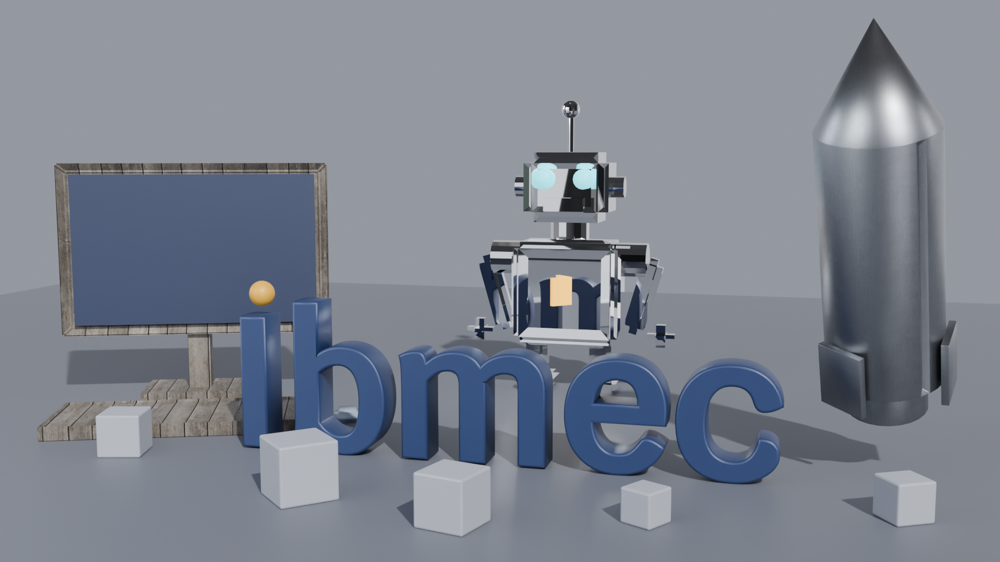
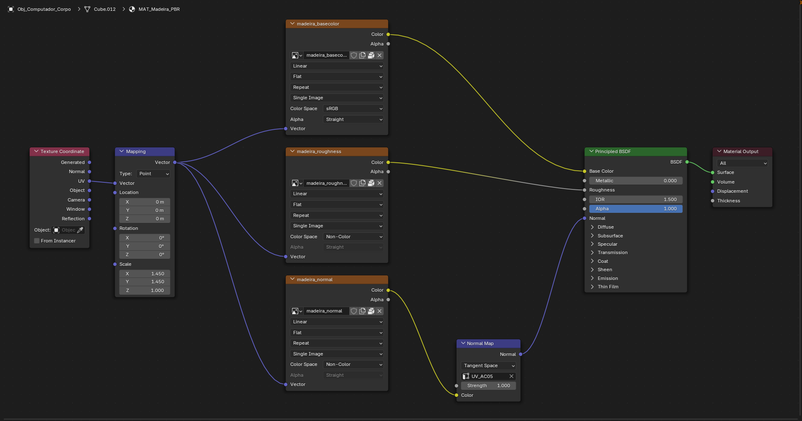
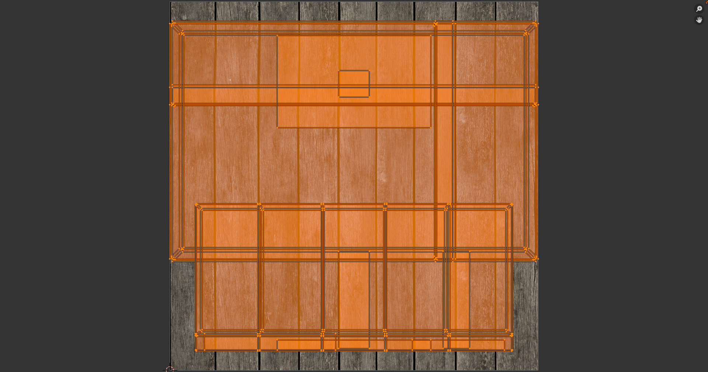
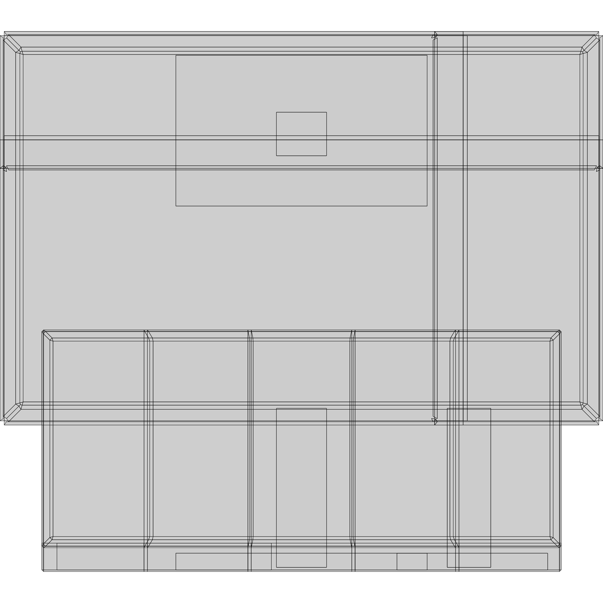
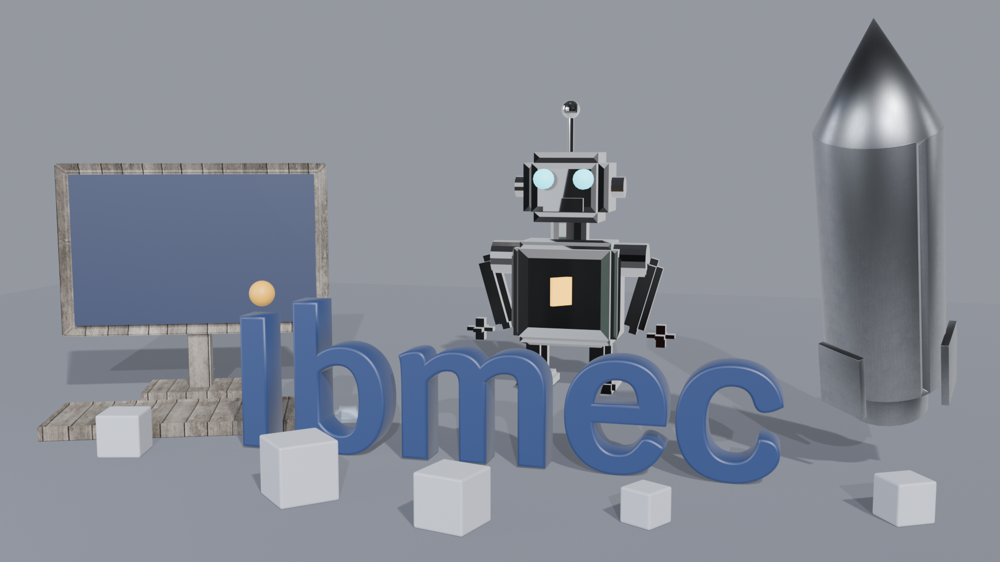
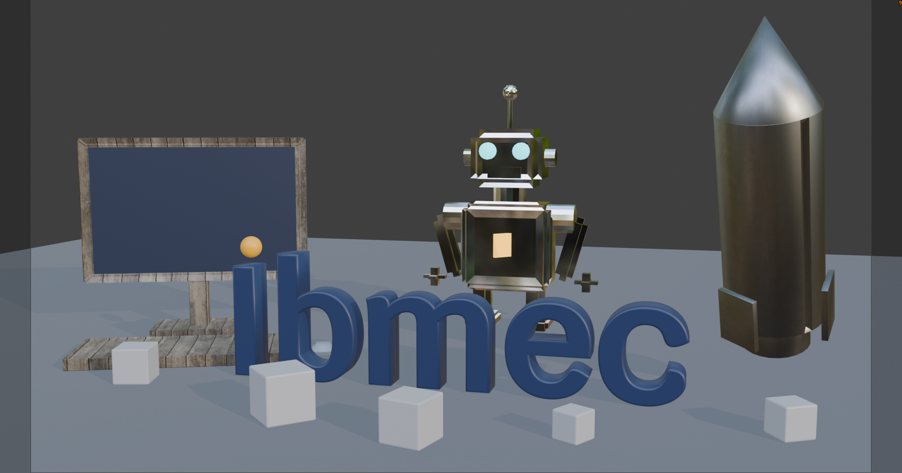
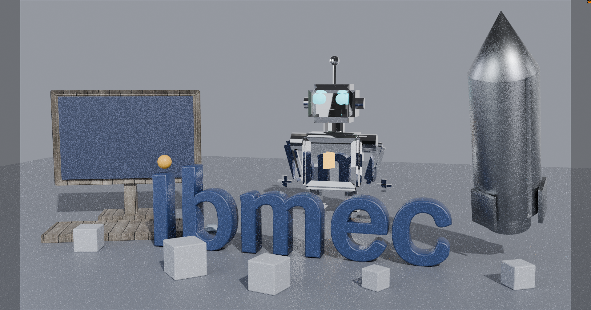

# AC05: Materiais PBR e texturas (Blender 4.5 LTS)

Autor: Michel Lutegar. Arquivo: `AC5/AC05_MichelLutegar.blend` (cópia da cena da AP1 com as luzes da AC04; AP1 e AC04 intactas).
Script: `AC5/ac05_materiais_texturas.py`. Validação: `AC5/validar_ac05.py` (saída em `AC5/saida/validacao.txt`).



## 1. Objetos e materiais aplicados

| Objeto autoral | Malha recebedora | Material | Justificativa |
|---|---|---|---|
| Obj_Robo | Obj_Robo_Corpo | MAT_Espelho_PBR | O robô-mascote é o personagem central e fica no meio da composição. Uma superfície espelhada reflete a palavra, o chão e os outros objetos, ligando visualmente os elementos da cena. |
| Obj_Computador | Obj_Computador_Corpo | MAT_Madeira_PBR | Corpo do computador (moldura, pescoço, base e teclado) em madeira. Remete à base sólida e à construção do conceito da AP1, e contrasta com a tela azul. Forma de caixas, ideal para projeção em cubo. |
| Obj_Foguete | Obj_Foguete_Corpo | MAT_Metal_Escovado_PBR | Foguete é naturalmente metálico (fuselagem de alumínio ou aço). O escovado dá o ar de "futuro" do conceito sem espelhar demais. |
| Palavra_Ibmec | Palavra_Ibmec | MAT_Ibmec_PBR | Mantém o azul-marinho da marca, sem textura. |
| Ponto do "i" | Palavra_Ponto_i | MAT_Ibmec_Ponto_PBR | Mantém o laranja da marca, sem textura. |

Subpartes (tela, mouse, olhos, peito do robô, chão e blocos) mantêm os materiais da AP1. A malha da palavra e a esfera do ponto são objetos separados, por isso a identidade visual usa dois materiais Ibmec.

## 2. Propriedades principais dos materiais (Principled BSDF)

| Material | Base Color | Roughness | Metallic | Outros |
|---|---|---|---|---|
| MAT_Ibmec_PBR | (0.02, 0.04, 0.12) azul-marinho | 0.45 | 0 | sem textura, sem bump/normal |
| MAT_Ibmec_Ponto_PBR | (0.95, 0.48, 0.03) laranja | 0.45 | 0 | sem textura, sem bump/normal |
| MAT_Madeira_PBR | textura `madeira_basecolor` (sRGB) | textura `madeira_roughness` (Non-Color), valores originais do mapa | 0 | Normal Map, Strength 1.0 |
| MAT_Metal_Escovado_PBR | textura `metal_basecolor` (sRGB) | textura `metal_roughness` remapeada para 0.30 a 0.50 | 1 | Normal Map, Strength 0.8 |
| MAT_Espelho_PBR | (0.95, 0.95, 0.95) | 0.02 | 1 | sem textura |

## 3. Mapas utilizados e conexões

Os dois materiais texturizados usam o mesmo esquema (madeira e metal):

```
Texture Coordinate (UV) -> Mapping (Scale) -> Image Texture (Base Color, sRGB)  -> Principled: Base Color
                                           -> Image Texture (Roughness, Non-Color) -> [Map Range 0.30..0.50, só no metal] -> Principled: Roughness
                                           -> Image Texture (Normal, Non-Color)    -> Normal Map (Tangent Space, UV_AC05) -> Principled: Normal
```

- Base Color: cor, interpretada como sRGB.
- Roughness e Normal: dados, configurados como Non-Color.
- O mapa normal passa obrigatoriamente pelo nó Normal Map (Tangent Space) antes do Normal do Principled BSDF. Os mapas são OpenGL (Y+), formato esperado pelo Blender.
- No metal, um nó Map Range com Clamp limita a rugosidade final à faixa 0.30 a 0.50 pedida pelo enunciado.
- Mapa Metallic não foi usado: a madeira é não metálica (0) e o metal é uniforme (1), então um mapa não acrescentaria nada.
- Pelo menos duas texturas de imagem: madeira (computador) e metal (foguete), ambas com os três canais.

Captura do Shader Editor com `MAT_Madeira_PBR` (Obj_Computador_Corpo): Image Texture sRGB -> Base Color; Image Texture Non-Color -> Roughness; Image Texture Non-Color -> Normal Map (Tangent Space, UV_AC05) -> Normal.



## 4. Método de UV e ajustes

Mapa UV chamado `UV_AC05` em cada objeto texturizado.

| Objeto | Método | Por quê |
|---|---|---|
| Obj_Computador_Corpo | Cube Projection (`cube_size` igual à maior dimensão, 3.6) | Peça formada por caixas (moldura, base, teclado, pescoço). A projeção em cubo mantém as faces planas sem esticamento e as tábuas alinhadas. |
| Obj_Foguete_Corpo | Unwrap (Angle Based) com seams marcadas via bmesh: arestas vivas (diedro acima de 60 graus, que separam aletas e bocal) e uma linha longitudinal no lado de trás do corpo, oposto à câmera. Margem de ilha 0.02 e escala média das ilhas | A malha mistura cilindro, cone e aletas planas. As aletas ficam em ilhas próprias e o tubo abre pela linha de trás, então a emenda das estrias não aparece no enquadramento. Mantém o mapeamento por UV exigido pelo enunciado. |

Ajustes para reduzir distorção:
- Margem de 0.02 entre as ilhas do foguete, para evitar vazamento de textura entre ilhas.
- Escala real: o script calcula a relação entre a área de cada face no mundo e no UV, e usa o resultado para definir o `Scale` do nó Mapping. Assim um tile de textura representa um tamanho fixo na cena: 2.5 unidades para a madeira (Mapping 1.45) e 0.8 unidades para o metal (Mapping 7.34).
- Métrica automática: 100% das faces com densidade de texel entre 0.5x e 2x da mediana, nos dois objetos (sem esticamento relevante). No foguete, o ângulo de unwrap foi escolhido por teste: Conformal e Minimum Stretch deixavam de 3 a 4 faces do bocal ou do tubo fora da faixa, e o Angle Based com seam também no anel do bocal chegou a 100%.
- Costura do foguete: antes, o Smart UV Project deixava uma emenda vertical visível no lado direito do corpo, onde duas ilhas se encontravam com a estria em direções diferentes. Agora a seam fica a 101.3 graus em torno do eixo local, no lado oposto à câmera (calculado a partir da posição de `Cam_Principal`), e a emenda não aparece no enquadramento. O bocal tem uma seam própria no mesmo lado.

Captura do UV Editor de `Obj_Computador_Corpo` em modo de edição, com todas as faces selecionadas, o mapa `UV_AC05` e a textura de cor da madeira ao fundo. Layout exportado: `AC5/saida/AC05_uv_layout.png`.





## 5. Origem e licença das texturas

| Textura | Fonte | Autor | Licença |
|---|---|---|---|
| brown_planks_03 (1K, JPG) | Poly Haven, https://polyhaven.com/a/brown_planks_03 | Rob Tuytel | CC0 |
| Metal009 (1K, JPG) | ambientCG, https://ambientcg.com/a/Metal009 | ambientCG | CC0 |

| Studio Small 08 (HDRI 1K, .hdr) | Poly Haven, https://polyhaven.com/a/studio_small_08 | Sergej Majboroda | CC0 |

Detalhes e arquivos em `AC5/texturas/FONTES.md`. O HDRI e as seis imagens estão empacotados no `.blend` (File > External Data > Pack Resources, feito por `bpy.ops.file.pack_all`).

## 6. Iluminação e ajustes feitos (antes e depois)

Câmera, enquadramento, Sol (4.0, branca, rot 50, 0, 35) e luz de preenchimento (Area 250 W) são idênticos aos da AC04.

| Item | Antes (AC04) | Depois (AC05) | Motivo |
|---|---|---|---|
| World (reflexos) | fundo cinza (0.32, 0.34, 0.40) para todos os raios | Mix Shader: cinza da AC04 + HDRI Studio Small 08, misturados por Light Path > Is Glossy Ray (0 = cinza, 1 = HDRI) | O robô espelhado refletia só o cinza do mundo e as faixas, e se confundia com o fundo. Com o HDRI só nos raios glossy ele passa a refletir um estúdio com softboxes. |
| Elementos auxiliares | nenhum | nenhum (as faixas `Refletor_1..3` foram testadas e removidas) | Com o HDRI, as faixas deixaram o rosto do robô branco estourado e escondiam os detalhes. A coleção `AC05_Materiais_Texturas` deixou de ser necessária. |
| Luzes e câmera | valores AC04 | iguais | nenhuma mudança |

Observações:
- Por que o HDRI não altera a iluminação dos objetos: a câmera e os raios difusos (que carregam a luz indireta e a cor do ambiente) não são raios glossy, então continuam vendo exatamente o cinza uniforme da AC04. Só os reflexos nítidos dos materiais metálicos e do espelho consultam o HDRI. O fundo da imagem, o brilho do chão e a cor da palavra Ibmec ficam iguais.
- Espelho (Roughness 0.02, mantido) no Cycles reflete o estúdio do HDRI, a palavra Ibmec e o chão. O robô ganha contornos escuros e brilhos nas arestas e se destaca do fundo. Os valores 0.05 a 0.08 não foram necessários.
- Teste das faixas: com `Refletor_1..3` somadas ao HDRI, o rosto do robô ficava branco estourado. Sem as faixas, o rosto mantém o contraste. Por isso foram removidas (o interruptor `AC05_REFLETORES=1` do script as recria para comparação).
- Metal escovado (Roughness 0.30 a 0.50) gera um brilho largo e suave na ponta do foguete, com estrias finas do mapa normal visíveis na fuselagem.
- Madeira (Metallic 0, rugosidade alta) responde quase só à luz difusa, sem reflexos nítidos. O mapa normal marca as juntas das tábuas.
- A palavra Ibmec permanece legível e com as cores da marca. A composição da AP1 foi preservada.

## 7. Renders e tempos

| Saída | Arquivo | Tempo |
|---|---|---|
| Cycles, 1920x1080, 96 amostras, CPU, denoise (principal) | `AC5/saida/AC05_render.png` | 88.3 s |
| Eevee, 1920x1080, 64 amostras (comparação) | `AC5/saida/AC05_render_eevee.png` | 1.8 s |



Diferença: o Cycles traça raios reais e mostra no robô os reflexos do estúdio, da palavra e do chão. No Eevee o robô aparece escuro e sem reflexos detalhados, porque o Eevee não reflete o ramo glossy do World como o Cycles. Metal e madeira ficam parecidos nos dois motores. O Eevee é cerca de 49 vezes mais rápido, por isso serve para testar e o Cycles é usado na imagem final.

## 8. Material Preview x Rendered

Comparação feita pela câmera principal, com a mesma resolução (1920x1080).

| Modo | Arquivo | Observação |
|---|---|---|
| Material Preview (viewport, vista da câmera, sem overlays e gizmos) | `AC5/saida/AC05_viewport_material_preview.png` | Madeira, metal e cores da marca aparecem como no Rendered. O robô espelhado fica escuro, com poucos reflexos. |
| Rendered (viewport Cycles, 128 amostras com denoise) | `AC5/saida/AC05_viewport_rendered.png` | O robô reflete o estúdio do HDRI e se destaca do fundo; o metal do foguete tem brilho mais definido e sem emenda visível. |





Decisão: `AC05_material_preview.png` (Eevee, sem interface) foi mantido em `AC5/saida/` como arquivo auxiliar, mas não é mais usado nesta seção; as capturas do viewport o substituem. Capturas geradas por `AC5/capturas_ac05.py`.

A diferença principal está nos reflexos do espelho. Escala, orientação e repetição das texturas são iguais nos dois modos, o que confirma que o UV e o Mapping estão corretos.

## 9. Validação automática

`AC5/validar_ac05.py` confere 62 itens (materiais, Principled BSDF, valores PBR, ligações dos nós, colorspace, Normal Map, UV, imagens e HDRI empacotados, World com HDRI só em raios glossy, seams do foguete, ausência das faixas auxiliares, Ibmec sem textura, câmera e luzes). Resultado: 62/62 OK. Saída completa em `AC5/saida/validacao.txt`.
