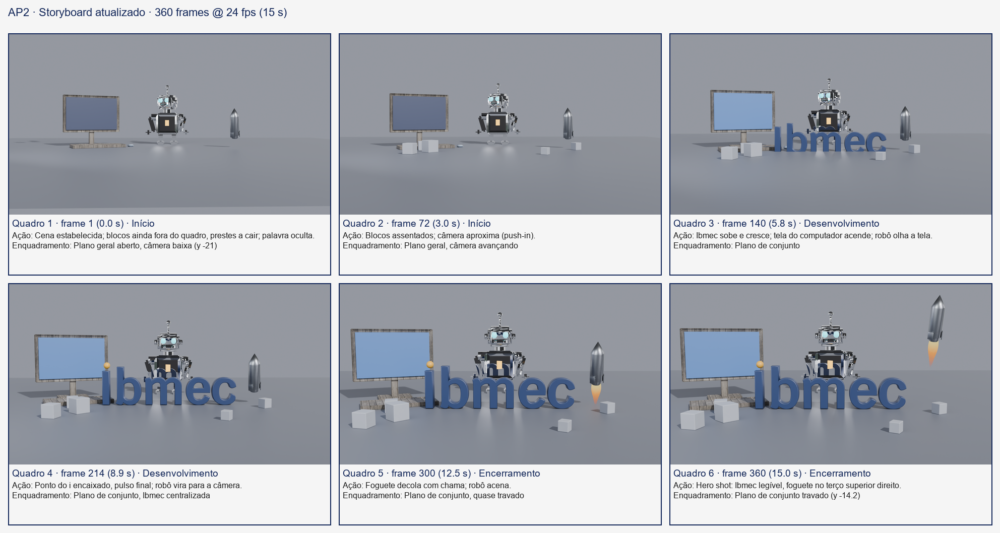
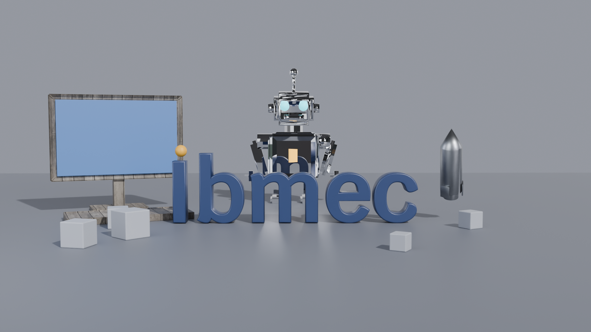
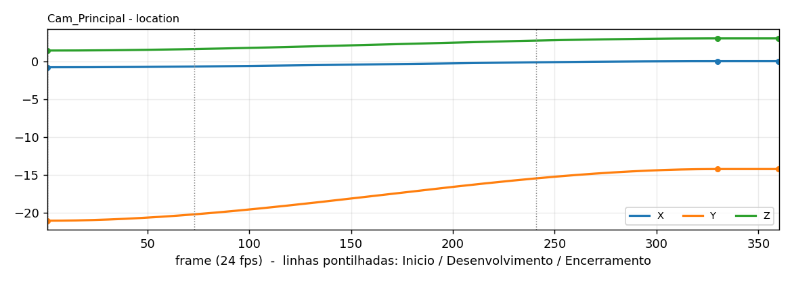
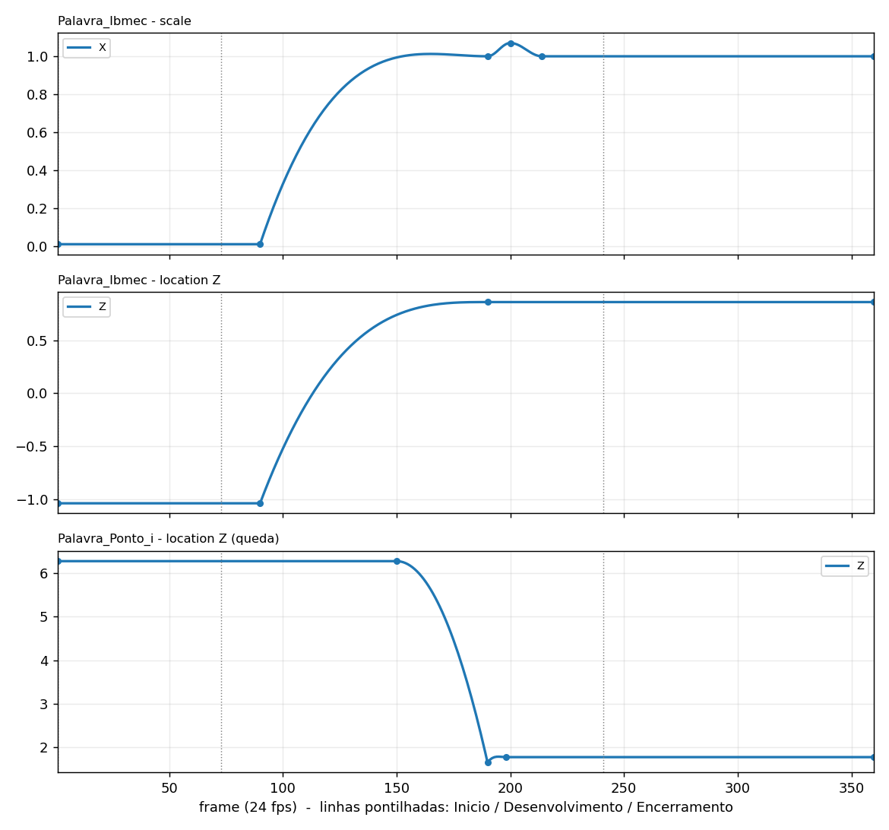
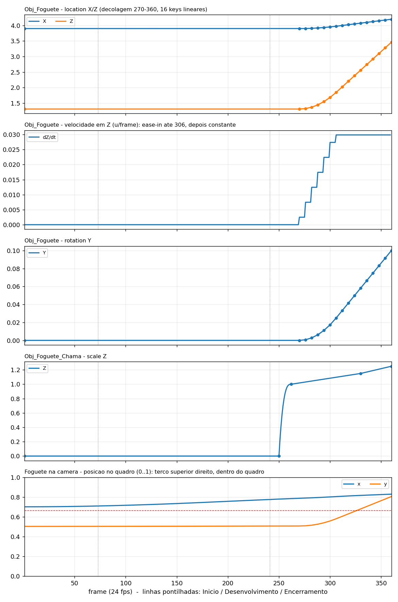
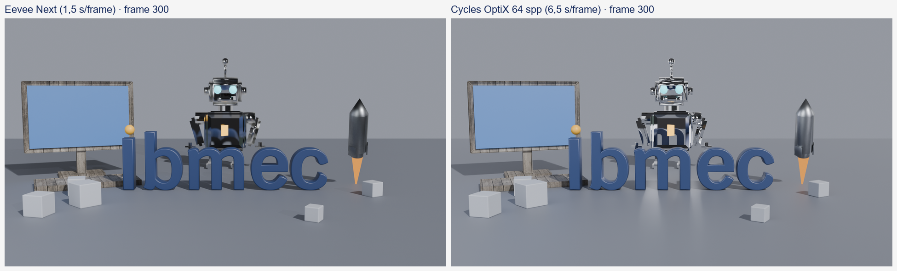
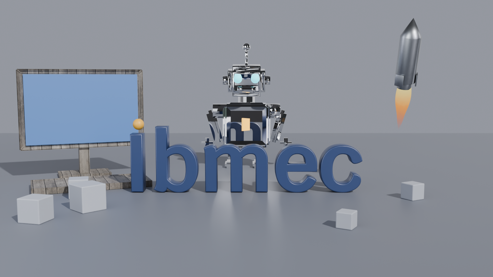

# AP2: Ibmec em 15 segundos (finalização)

**Disciplina:** Computação Gráfica
**Aluno:** Michel Lutegar
**Ferramenta:** Blender 4.5 LTS (Cycles, OptiX)
**Base:** cena da AC05 (materiais e UVs), iluminação da AC04, conceito e storyboard da AP1

## 1. Título, conceito e resumo da sequência

**Conceito.** "Construindo o Futuro": blocos de construção se assentam, a palavra **Ibmec** se ergue ao centro e, em volta dela, os três objetos autorais da AP1 participam da ação: o **computador** acende a tela, o **robô** observa a tela, vira para a câmera e acena, e o **foguete** decola no encerramento, sempre dentro do quadro. A palavra é o elemento principal e fica legível e parada de 214 a 360.

**Resumo.** São 360 frames a 24 fps (15 s), em três momentos, com marcadores no `.blend` (1 Inicio, 73 Desenvolvimento, 241 Encerramento). Câmera em *push-in* contínuo de 1 a 330 e travada de 330 a 360 (hero shot).

## 2. Momentos e planos

| Momento | Frames (tempo) | Ação | Enquadramento | Papel dos objetos |
|---|---|---|---|---|
| Início | 1 a 72 (0 a 3 s) | Cena estabelecida; os 5 blocos caem escalonados e se assentam | Plano geral aberto, câmera baixa (y -21) avançando | Blocos: caem e quicam. Computador, robô, foguete: parados, já compondo as laterais. Ibmec: oculta |
| Desenvolvimento | 73 a 240 (3 a 10 s) | Ibmec sobe e cresce (90 a 190), tela acende (120 a 150), ponto do i cai e encaixa (150 a 198), pulso da palavra (190 a 214), robô vira para a câmera (200 a 230) | Plano de conjunto, câmera continua aproximando | Ibmec: protagonista. Computador: tela azul como ponto de atenção. Robô: olha a tela e depois a câmera. Foguete: parado |
| Encerramento | 241 a 360 (10 a 15 s) | Robô acena (250 a 290), chama acende (250), foguete decola (270 a 360), câmera para em 330 | Plano de conjunto travado (y -14.2), Ibmec centralizada | Ibmec parada e legível. Robô: aceno. Foguete: sobe até o terço superior direito, inteiro no quadro. Blocos: já fora da marca |

### Mudanças em relação ao storyboard da AP1
O storyboard da AP1 previa os mesmos três momentos (1 a 72, 73 a 240, 241 a 360). Foram mantidos a divisão, o clímax com a palavra ao centro e o foguete decolando à direita. O que mudou:

- **Robô e computador animados.** Na AP1 eram apenas cenário. Agora o computador acende a tela (120 a 150) e o robô olha a tela, vira para a câmera e acena.
- **Foguete fica no quadro.** Na primeira tentativa ele saía pelo topo. Agora tem 45% do tamanho, sobe de (3,9; 0,2; 1,31) a (4,2; 0,2; 3,46) e termina inteiro no terço superior direito, com chama.
- **Blocos reposicionados.** Os blocos 03, 04 e 05 ficavam na frente da palavra. Passaram para (-3,6; -2,0), (2,0; -3,5) e (-4,4; -3,0), fora do retângulo da Ibmec de 190 a 360.
- **Câmera.** Passou a ser um *push-in* de (-0,8; -21; 1,4) a (0; -14,2; 3,0) com travamento em 330 e alvo (Track To) rebaixado de z 2,0 para 1,4, para centralizar a palavra na vertical.
- **Marcadores.** O `.blend` usa Inicio (1), Desenvolvimento (73) e Encerramento (241), alinhados ao storyboard em frames.

## 3. Propriedades animadas e decisões de timing e interpolação

Tabela gerada do `.blend` por `AP2/gerar_curvas.py` (`AP2/saida/curvas/tabela_animacao.md`):

| Objeto | Propriedade | Frames | Interpolação |
|---|---|---|---|
| Aux_Bloco_01 a 05 | location | 1 a 360 (6 keys) | Constant, Quad ease-in, Quad ease-out, Linear |
| Aux_Bloco_01 a 05 | rotation_euler | 1 a 360 (4 keys) | Constant, Quad ease-out, Linear |
| Cam_Principal | location | 1 a 360 (3 keys) | Bezier, Linear |
| Obj_Foguete | location, rotation_euler | 1 a 360 (17 keys) | Constant, Linear |
| Obj_Foguete_Chama | scale | 1 a 360 (5 keys) | Constant, Cubic ease-out, Linear |
| Obj_Robo_Braco | rotation_euler | 1 a 360 (12 keys) | Back ease-out, Sine ease-in-out, Bezier, Quad ease-in-out, Linear |
| Obj_Robo_Cabeca | rotation_euler | 1 a 360 (4 keys) | Bezier, Back ease-out, Linear |
| Palavra_Ibmec | scale | 1 a 360 (6 keys) | Constant, Back ease-out, Sine ease-in-out, Linear |
| Palavra_Ibmec | location | 1 a 360 (4 keys) | Constant, Cubic ease-out, Linear |
| Palavra_Ponto_i | scale | 1 a 360 (4 keys) | Constant, Linear |
| Palavra_Ponto_i | location | 1 a 360 (5 keys) | Constant, Quad ease-in, Back ease-out, Linear |
| Mat_Obj_Computador_Tela | Emission Strength | 1 a 360 (7 keys) | Constant, Linear, Sine ease-out |

### Por que cada interpolação
- **Quad ease-in** (queda dos blocos e do ponto do i): objetos que caem aceleram. A curva parabólica imita a gravidade e o ease-in evita uma partida artificial. Depois da queda, o bloco usa **Quad ease-out** no pouso e um pequeno quique.
- **Back ease-out** (ponto do i, cabeça e braço do robô, entrada da palavra): passa levemente do valor final e volta, o que dá peso e "bate e encaixa". No ponto do i (frames 150 a 190) ele afunda 0,12 e sobe para encaixar em 198. Na cabeça do robô (até 200) é o pequeno exagero antes de assentar na nova direção.
- **Sine ease-in-out** (crescimento da palavra de 90 a 190, pulso 190 a 214, aceno do braço, tela): aceleração e frenagem suaves e simétricas, sem arrancada visível, ideal para movimentos que começam e terminam em repouso e para oscilações.
- **Cubic ease-out** (subida da palavra e acendimento da chama): chegada rápida e frenagem longa, para o elemento "pousar" na posição.
- **Bezier** (câmera): o trecho de 1 a 330 usa handles automáticos, que suavizam a partida e a chegada (ease in e ease out), e a câmera para em 330 sem solavanco. De 330 a 360 o valor é constante (hero shot travado).
- **Linear com amostragem a cada 6 frames** (foguete): o perfil de velocidade precisa ser exato. A decolagem tem ease-in parabólico de 270 a 306 e velocidade constante de 306 a 360 (0,0299 u/frame, razão entre as velocidades dos frames 318 e 354 igual a 1,000). Assim o foguete nunca "freia no ar". Os 16 keyframes lineares formam degraus de velocidade de 6 frames, imperceptíveis a 24 fps.
- **Constant**: usada só para manter objetos escondidos (escala 0,01) ou parados até o instante de entrada.

Curvas exportadas do Graph Editor (valores por frame, com os keyframes marcados):

## 4. Iluminação e renderização

### Iluminação
- `LUZ_Principal`: Sun, energia 4,0 (chave). `LUZ_Preenchimento`: Area, 250 W (suaviza sombras). Ambas vêm da AC05, escolhidas a partir dos testes da AC04.
- **Fundo cinza** neutro (0,32; 0,34; 0,40) para a marca azul e laranja se destacar.
- **HDRI** `studio_small_08` ligado ao World só para **raios glossy** (Light Path, Is Glossy Ray). Ele não ilumina nem aparece no fundo; serve para o robô espelhado e o metal escovado terem o que refletir.
- **Rim light testado e descartado.** Uma Area 7 x 1,2 atrás e acima da palavra não melhorou a leitura (frame 300, 960x540): luminância média das letras 0,437 para 0,449 e do fundo 0,534 para 0,540; contraste letra x fundo 0,097 para 0,091. Ficou desligado (`RIM = False`).
- **Emissões limitadas.** Com o tom AgX, emissões altas viram branco. Tela: pico 0,8 (antes 1,8, RGB médio lavado). Chama: Strength 1,2 (antes 6,0, quase branca). Os limites ficam gravados na cena (`ap2_limite_tela`, `ap2_limite_chama`) e o validador os confere. Nenhum pixel com canal acima de 0,98 nos frames testados.
- **Marca**: dentro do retângulo da palavra o azul médio é (0,24; 0,33; 0,50) no Cycles, sem pixels estourados nem escuros.
- **Sobre os modelos de iluminação:** o material usa o **Principled BSDF, que é baseado em princípios físicos e não é uma implementação de Phong nem de Blinn-Phong**. Lambert, Phong e Blinn-Phong foram estudados na AC04 como referência conceitual (difuso, brilho especular), mas a aparência final vem do modelo PBR (rugosidade, metalicidade, reflexão de Fresnel).

### Renderização
- **Motor final: Cycles, dispositivo GPU OptiX, 64 amostras (spp), denoiser OptiX.** 1920x1080, 24 fps, frames 1 a 360, **motion blur ligado com obturador 0,35**. Motion blur avaliado: no frame 214 a palavra tem nitidez idêntica com e sem blur, o foguete perde 2,6% e só o ponto do i em queda perde nitidez, pousando nítido em 198.
- **Eevee Next x Cycles** (RTX 3050, 1920x1080, depois de 1 frame de aquecimento):

| Frame | Eevee Next | Cycles OptiX 64 spp | Observação |
|---|---|---|---|
| 1 | 1,3 s | 4,6 s | Eevee: robô e foguete escuros |
| 200 | 1,4 s | 5,9 s | Cycles reflete o HDRI e a palavra no robô |
| 300 | 1,5 s | 6,5 s | Eevee: foguete preto; Cycles: metal com realces |
| 360 | 1,5 s | 6,6 s | Mesmo enquadramento, material melhor no Cycles |

  O Eevee é cerca de 4 vezes mais rápido (aprox. 8,5 min para a sequência), mas o robô espelhado e o metal escovado, que são o que a AC05 construiu, só funcionam bem no Cycles. Foi escolhido o Cycles. Dados em `AP2/saida/teste_motor/tempos.csv`.

- **Render final**: 360 frames em 1953 s (32 min 33 s, 5,4 s por frame), sequência de PNG e montagem do vídeo com ffmpeg, H.264, CRF 14.
- **Exportação e conferência com ffprobe** (`AP2/AP2_MichelLutegar.mp4`): `h264` (High), 1920x1080, `yuv420p`, 24/1 fps, 360 frames, duração 15,000 s, 7,3 MB, sem trilha de áudio.

## 5. Materiais e texturas da AC05 reaproveitados e ajustados

| Objeto | Material | Origem e ajuste |
|---|---|---|
| Robô | `MAT_Espelho_PBR` | AC05 sem mudança. Só foi separado em `Obj_Robo_Cabeca` e `Obj_Robo_Braco` (a malha tinha 18 ilhas soltas) com o mesmo material, para animar cabeça e braço |
| Computador (corpo) | `MAT_Madeira_PBR` (brown_planks_03) | AC05 sem mudança, sem animação |
| Computador (tela) | `Mat_Obj_Computador_Tela` | **Novo**: material próprio com emissão azul animada (pico 0,8). Assim a madeira não é alterada |
| Foguete (corpo) | `MAT_Metal_Escovado_PBR` (Metal009) | AC05 sem mudança |
| Foguete (chama) | `Mat_Foguete_Chama` | **Novo**: Emission x Transparent BSDF com gradiente em Z (amarelo, laranja, vermelho), opacidade que cai na ponta, ruído 4D por driver e Strength 1,2 |
| Ibmec | `MAT_Ibmec_PBR`, `MAT_Ibmec_Ponto_PBR` | AC05, azul e laranja da marca, sem emissão (a cor vem do difuso) |

Mapas: cor base em sRGB; rugosidade e normal em Non-Color; normal passando pelo nó **Normal Map** (formato OpenGL). As 7 imagens ficam empacotadas no `.blend` (ver "Imagens" abaixo).

**Verificação em movimento** (Cycles, recortes em tamanho real em `AP2/saida/texturas_movimento/`): foguete nos frames 270, 315 e 360 e computador nos frames 1, 200 e 360. Escala do metal e da madeira coerente entre frames, sem esticamento, sem repetição visível e sem moiré mesmo no plano aberto. As UVs da AC05 não precisaram de correção. A **costura do foguete** (seam do desdobramento da AC05) foi posicionada na parte de trás, e a verificação com a câmera em movimento confirmou que ela não aparece.

**Imagens do `.blend`.** O arquivo contém 7 imagens de arquivo, todas empacotadas e com 1 uso cada: `hdri_studio_small_08`, `madeira_basecolor`, `madeira_normal`, `madeira_roughness`, `metal_basecolor`, `metal_normal`, `metal_roughness`. Há também o `Render Result`, um visualizador interno do Blender (0x0 px, não é arquivo e não se empacota). Contá-lo como imagem dá 8. Não há imagem órfã.

## 6. Desafios e soluções

| Desafio | Solução |
|---|---|
| **AP2 antiga com objetos errados.** O script da AP2 era cópia de uma AP1 antiga (Livro, Torre, Foguete), sem os materiais da AC05 | Novo script que abre a cena da AC05 em modo leitura, organiza coleções e anima. A versão antiga foi preservada em `AP2/_versao_antiga/` |
| **Robô escuro no Eevee.** O robô espelhado e o foguete ficavam quase pretos sem reflexos | Testados HDRI 0,3 a 3,0 e raytracing de reflexos. Valores altos lavam o difuso. A decisão foi renderizar em Cycles, onde o World da AC05 (HDRI só em raios glossy) funciona como projetado |
| **Foguete saindo do quadro.** Decolava e deixava o enquadramento | Escala 45%, destino calculado pela projeção na câmera e perfil ease-in mais velocidade constante. O validador confere o quadro de 270 a 360 e a margem de 2% |
| **Blocos cobrindo a marca.** Três blocos ficavam na frente da Ibmec | Busca em grade de posições finais; nenhum bloco toca o retângulo da palavra de 190 a 360 (verificado a cada 2 frames, margem 0,8%) |
| **Tela e chama estouradas.** Brancas por causa do AgX | Emissões reduzidas (tela 1,8 para 0,8; chama 6,0 para 1,2), limites gravados na cena e checados no validador |
| **Costura do foguete.** Risco de a seam aparecer com a câmera e o foguete em movimento | Seam atrás do objeto desde a AC05; conferido nos frames 270, 315 e 360 |
| **Contagem de imagens divergente (7 x 8).** Uma cópia isolada relatou 8 empacotadas | O oitavo item é o `Render Result`, que não é arquivo. O validador agora lista os 7 arquivos, exige que nenhum esteja órfão e que o único item restante seja o `Render Result` |

## 7. Fontes e licenças

| Recurso | Fonte | Autor | Licença | Uso |
|---|---|---|---|---|
| `brown_planks_03` (1K) | Poly Haven, https://polyhaven.com/a/brown_planks_03 | Rob Tuytel | CC0 | Madeira do computador |
| `studio_small_08` (HDRI 1K) | Poly Haven, https://polyhaven.com/a/studio_small_08 | Sergej Majboroda | CC0 | Reflexos (só raios glossy) |
| `Metal009` (1K) | ambientCG, https://ambientcg.com/a/Metal009 | ambientCG | CC0 | Metal do foguete |
| Fonte **Krub SemiBold** (`Krub-SemiBold.ttf`) | Google Fonts, https://fonts.google.com/specimen/Krub | Cadson Demak | SIL Open Font License 1.1 (o arquivo de licença não está no repositório; confirmar na aba License da página da fonte) | Letras "bmec" da palavra, criadas na AP1 como texto e convertidas em malha |
| Logotipo `LOGO_IBMEC_3D.blend` | Material da disciplina/marca Ibmec | Ibmec | Marca registrada; uso acadêmico | Malhas do "I" e do ponto laranja (AP1) |

Observação: as letras "bmec" são malhas, então o `.blend` da AP2 não depende da fonte instalada (a AP1 referenciava `Krub-SemiBold.ttf` em `%LOCALAPPDATA%\Microsoft\Windows\Fonts`). A pasta `AP1/assets/fonts/` contém arquivos da família **Lagu Sans**, fonte original do logotipo. Ela não foi usada na renderização (modo "B" da AP1, com "bmec" em Krub) e a licença dela não está identificada, por isso não é citada como recurso utilizado. Texturas e HDRI são CC0 e não exigem atribuição, mas ela é dada. Detalhes em `AC5/texturas/FONTES.md`. **Sem áudio**: o vídeo não tem trilha de som.

## 8. Entregáveis

| Item | Caminho |
|---|---|
| Arquivo Blender (cena, animação, materiais, luz, câmera, saída) | `AP2/AP2_MichelLutegar.blend` |
| Vídeo final (15 s, 24 fps, H.264) | `AP2/AP2_MichelLutegar.mp4` |
| Frame final (360) | `AP2/saida/AP2_MichelLutegar_frame_final.png` |
| Frame 214 | `AP2/saida/AP2_MichelLutegar_frame_214.png` |
| Storyboard atualizado | `AP2/storyboard/AP2_storyboard.png` |
| Curvas de animação | `AP2/saida/curvas/` (3 PNG e `tabela_animacao.md`) |
| Comparação de motor | `AP2/saida/comparacao_motor.png`, `AP2/saida/teste_motor/` |
| Prévias, folhas de contato, texturas em movimento, chama | `AP2/saida/previas/`, `folha_contato_*.png`, `texturas_movimento/`, `chama/` |
| Scripts | `AP2/ap2_ibmec_final.py`, `AP2/validar_ap2.py`, `AP2/gerar_curvas.py`, `AP2/gerar_storyboard.py` |
| Validação | `validar_ap2.py`: 65/65 OK; `AC5/validar_ac05.py`: 62/62 OK |

## 9. Autoria e ferramentas

Autor: **Michel Lutegar**. Cena, animação, iluminação, materiais e render feitos no **Blender 4.5 LTS** com automação em **Python** (`bpy`), no Windows, com GPU NVIDIA RTX 3050 (Cycles OptiX). **ffmpeg/ffprobe** para montar e conferir o vídeo; **Matplotlib** para as curvas e **Pillow** para o storyboard e a comparação de motor. O desenvolvimento dos scripts e deste relatório contou com apoio de um assistente de IA (Claude Code), com revisão e decisões do autor. Texturas e HDRI de Poly Haven e ambientCG (CC0).
